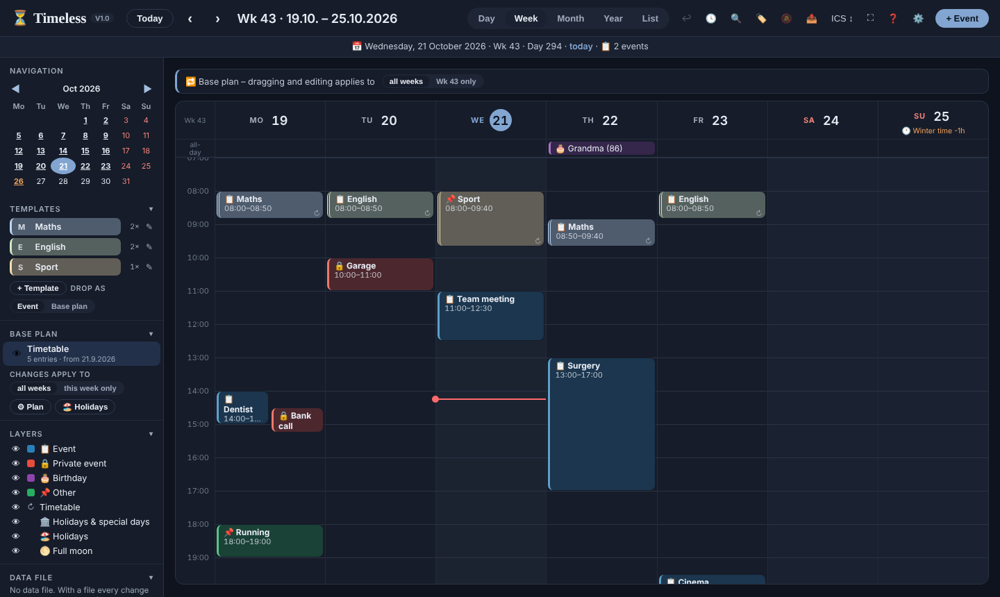
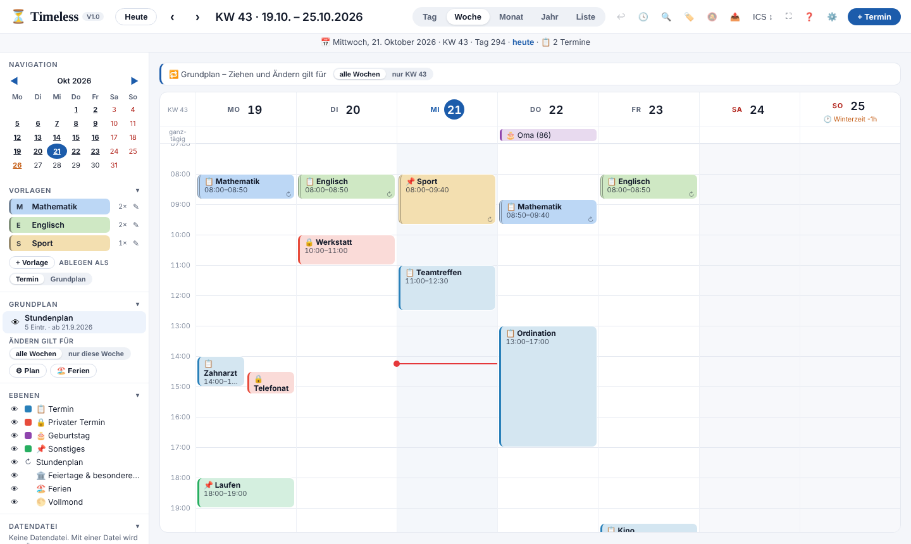

# ⏳ Timeless

**Calendar, timetable and appointment book in one single HTML file – offline, private, no account.**
**Kalender, Stundenplan und Terminbuch in einer einzigen HTML-Datei – offline, privat, ohne Konto.**

🇬🇧 [English](#english) · 🇩🇪 [Deutsch](#deutsch)

---

## English

Timeless merges three of my earlier projects – **Endless Calendar Pro**, **timetable** and **Terminbuch** – into one calendar with a modern week view. You drag, stretch and copy events right in the time grid. Templates and a weekly base plan cover school or work timetables. The workload heatmap and free-slot search help you book appointments.

**Try it:** open the [live page](https://heinzbundschuh.github.io/timeless/), or download `index.html` and double-click it. Nothing else is needed.

### Highlights

- **Time grid (week & day)**
  - Drag events to another time or day. Stretch them at the bottom edge, or press and drag in a free spot to draw a new one.
  - **Ctrl/Shift + drag** copies.
  - Drag the **left/right edge** across neighbouring days to copy an event to each of them.
  - Overlapping events are shown **side by side** or **staggered** (like Etar).
  - If an event lands on busy time, Timeless offers to **move the following events back** (as in the appointment book).
  - Dragging a recurring event asks: **this one**, **this and following**, or **the whole series**.
- **Templates & base plan**
  - Build a weekly plan from templates: drag them into the grid, or click them and use them like a brush.
  - Each change applies to **all weeks** or **this week only**.
  - **Past weeks keep their state** and are locked, so you can check them later.
  - Austrian school holidays (Burgenland) are preset and can be calculated for later years. Public holidays and school holidays pause the plan.
- **Booking aids**
  - 🔥 workload heatmap in month and year view, with “n free” per day
  - 🕓 next free slot from a chosen date
  - title suggestions from earlier events and templates
- **Powerful recurrence** (from Endless Calendar Pro): yearly, monthly, weekly, n-th weekday, every n days, weeks, months or years, hourly series, weekday/month masks, exceptions, relative to Easter or Advent, birthdays with memorial days.
- **Alerts with a colour wave and a bell sound** (generated in the browser, no sound file). Snooze for 5 minutes, or get a system notification while Timeless runs in the background.
- **Export** 📤
  - PDF event list, PDF week picture (one page per week), JPG week picture
  - Word, OpenDocument Text, Excel, OpenDocument Spreadsheet
  - HTML, Markdown, Text and **ICS**
  - All of it built without external libraries.
- **Print** (Ctrl+P): week, day or month neatly on A4 landscape.
- **Layers**: show or hide each category, each base plan, holidays, school holidays and full moon. This also applies to exports.
- **Your data stays with you**
  - in the browser’s storage, plus optionally a **data file** (Chrome/Edge) that is written automatically after every change
  - JSON backup, ICS import with preview, duplicate clean-up, 30-step undo
- **German / English** UI (⚙️ Settings or Help). By default Timeless follows the browser language.
- **Keyboard:** `T` today · `←` `→` page · `1`–`5` views · `N` new event · `F` free slot · `/` search · `E` export · `?` help

### Install as an app

Open the [live page](https://heinzbundschuh.github.io/timeless/) in Chrome, Edge or Android Chrome and choose **Install app** (⚙️ → 📲, or the browser menu). Timeless then gets its own window and an icon on the home screen or start menu, and it also works offline.

The file `index.html` on its own works anywhere, including double-clicking it from a USB stick. The companion files (`manifest.webmanifest`, `sw.js`, icons) only matter on the web page.

> **Note:** browsers keep data separately per address. The local file and the web page each have their own storage. To move your data between them, use the **data file** or **ICS ↕ → JSON backup**.

### Files

| File | Purpose |
|---|---|
| `index.html` | the complete app (one file) |
| `manifest.webmanifest`, `sw.js`, `icon-*.png`, `apple-touch-icon.png` | needed only for installing from the web page and for offline use |
| `screenshots/` | images for this README |

### Coming from Endless Calendar Pro?

If both files are opened in the **same browser** as local files, Timeless copies your events on its first start. Endless Calendar Pro itself stays untouched. Otherwise, export a JSON backup there and load it in Timeless via **ICS ↕ → JSON backup**.

### Holidays outside Austria

Public holidays (Austria) and school holidays (Burgenland) live in clearly marked blocks in the code. School holidays can also be edited in the app (🏖️ Holidays). Forks for other countries are welcome.

---

## Deutsch

Timeless vereint drei meiner Projekte zu einem Kalender mit moderner Wochenansicht: **Endless Calendar Pro**, **timetable** (Stundenplan) und **Terminbuch**. Termine werden direkt im Zeitraster gezogen, verlängert und kopiert. Vorlagen und ein wöchentlicher Grundplan decken Stundenplan und Dienstplan ab. Auslastung und Freie-Termine-Suche helfen bei der Terminvergabe.

**Ausprobieren:** [Seite öffnen](https://heinzbundschuh.github.io/timeless/) – oder `index.html` herunterladen und doppelklicken. Mehr braucht es nicht.

### Das kann Timeless

- **Zeitraster (Woche, Tag)**
  - Termine ziehen, am unteren Rand verlängern, in einer freien Stelle neu aufziehen.
  - **Strg/Umschalt + Ziehen** kopiert.
  - Am **linken/rechten Rand** über die Nachbartage ziehen: an jedem Tag eine Kopie.
  - Überlappende Termine **nebeneinander** oder **versetzt** (wie Etar).
  - **Nachrücken** bei Überschneidung.
  - Serien wahlweise **nur dieses**, **dieses und folgende** oder **ganze Serie** verschieben.
- **Vorlagen & Grundplan**
  - Wochenplan aus Vorlagen, per Ziehen oder Pinsel.
  - Änderungen für **alle Wochen** oder **nur diese Woche**.
  - **Vergangene Wochen bleiben unverändert** zur Nachkontrolle.
  - Ferien Burgenland vorbelegt und berechenbar; Feiertage und Ferien setzen den Plan aus.
- **Terminvergabe**: 🔥 Auslastung (Heatmap) in Monat und Jahr, 🕓 nächster freier Termin, Namensvorschläge.
- **Wiederholungen** wie in Endless Calendar Pro: jährlich, monatlich, wöchentlich, n-ter Wochentag, Intervalle, Stundenserien, Wochentags- und Monatsmasken, Ausnahmen, relativ zu Ostern oder Advent, Geburtstage mit Gedenktag.
- **Hinweis mit Farbwelle und Glockenklang**, „5 Min. später“, Systembenachrichtigung.
- **Export** 📤: PDF (Liste oder Wochenbild), JPG, Word, ODT, Excel, ODS, HTML, Markdown, Text, ICS – ohne fremde Bibliothek.
- **Drucken** mit Strg+P.
- **Ebenen** zum Ein- und Ausblenden.
- **Datendatei** (Chrome/Edge), JSON-Sicherung, ICS-Import mit Vorschau, Duplikatbereinigung, 30 Schritte Rückgängig.
- **Deutsch / English** umschaltbar unter ⚙️.

### Als App installieren

Die [Seite](https://heinzbundschuh.github.io/timeless/) in Chrome, Edge oder Android-Chrome öffnen → ⚙️ → **📲 Als App installieren** (oder im Browser-Menü). Timeless läuft dann im eigenen Fenster, mit Symbol und auch offline. Als lokale Datei läuft `index.html` wie gewohnt ohne Installation.

> **Hinweis:** Browser trennen die Daten nach Adresse. Lokale Datei und Webseite haben jeweils einen eigenen Speicher. Zum Übertragen dient die **Datendatei** oder **ICS ↕ → JSON-Sicherung**.

### Umstieg von Endless Calendar Pro

Öffnest du beide als lokale Datei im selben Browser, übernimmt Timeless beim ersten Start die Termine. Endless Calendar Pro bleibt dabei unverändert. Sonst dort eine JSON-Sicherung speichern und in Timeless über **ICS ↕** laden.

---

## License / Lizenz

MIT – © 2026 Heinz Bundschuh. See [LICENSE](LICENSE).
